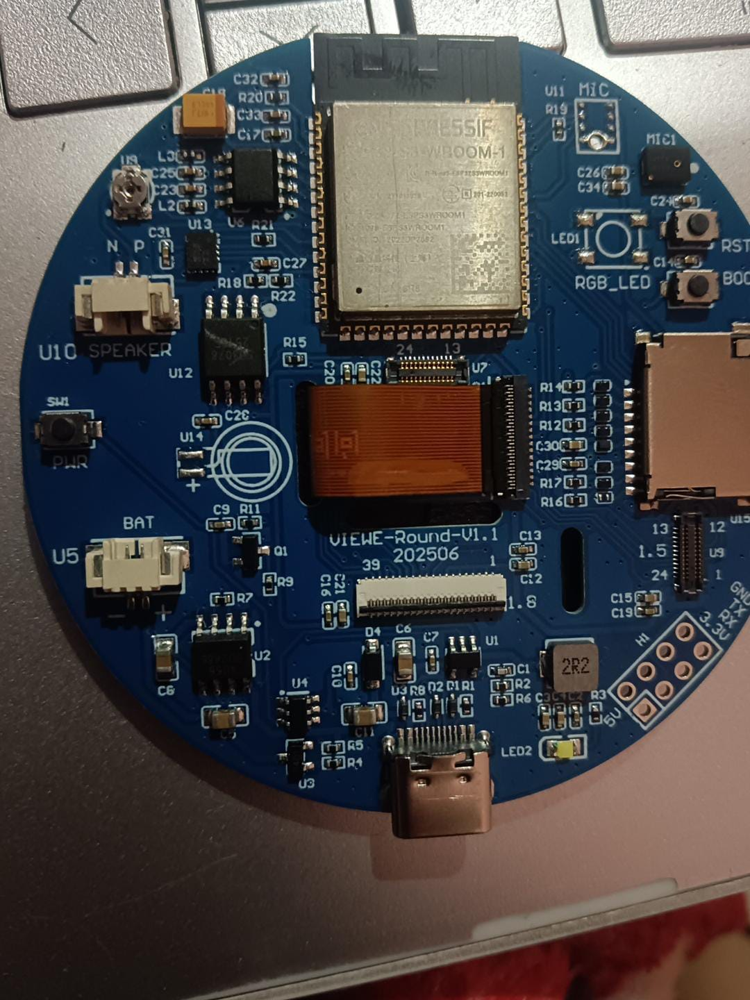
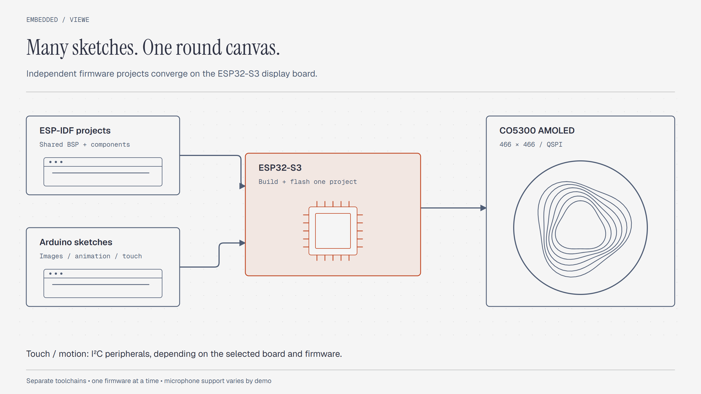
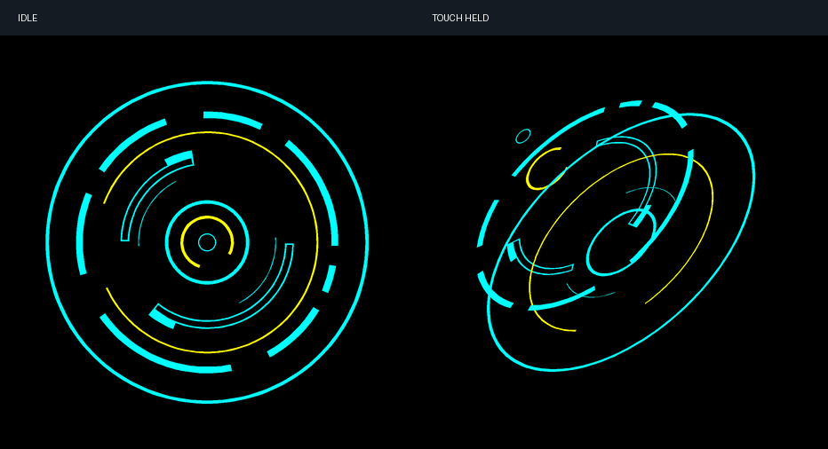

# VIEWE Round ESP32-S3

ESP32-S3 firmware and Arduino sketches for a round CO5300 AMOLED display. The collection includes LVGL demos, touch animations, FluidBox, and a Muse board port.



## Choose a project

| Project | Purpose | Start here |
|---|---|---|
| `02_lvgl_demo_v9` | LVGL widget demonstration | `Build.cmd` or `Flash.cmd` |
| `03_esp_brookesia` | Brookesia launcher and applications | `Build.cmd` or `Flash.cmd` |
| `04_Immersive_block` | Shapes controlled by touch or an identified QMI8658 | `Build.cmd` or `Flash.cmd` |
| `05_Spec_Analyzer` | Spectrum display experiment | [Recorded limitations](VIEWE-Demos/README.txt) |
| `esp-mosaico-fluidbox-main` | FluidBox with touch and tilt input | [Project guide](esp-mosaico-fluidbox-main/README.md) |
| `Muse-Offline-VIEWE` | Offline Muse interface with scripted interactions | [Flashing guide](Muse-Offline-VIEWE/README.txt) |
| `muse-board` | Muse SDK and VIEWE board adaptation | [Setup guide](muse-board/START-HERE.md) |
| `round_animations_co5300` | Graphics animations | Open the `.ino` file |
| `round_generative_art` | Generative graphics | Open the `.ino` file |
| `round_loader_animations` | Six loader animations | Open the `.ino` file |
| `round_url_display` | GIF, JPEG, and PNG display over Wi-Fi | Configure the sketch locally |
| `viewe_touch_rings` | Touch-responsive rings | [Arduino guide](viewe_touch_rings/README.md) |

## System design



The ESP-IDF demos share the BSP and component sources in `VIEWE-Demos`. Keep these directories beside each other.
Arduino sketches use their own graphics and input code. Each firmware image replaces the image currently running on the board.

## Hardware

The supplied board notes identify VIEWE-ROUND-V1.1 with 16 MB flash, 8 MB OPI PSRAM, and a 466 × 466 CO5300 panel.

| Interface | Connections |
|---|---|
| QSPI display | CS 12, CLK 48, D0 13, D1 47, D2 21, D3 14, RESET 11 |
| Touch I²C | SDA 17, SCL 18, RESET 10, INT 9 |
| BOOT button | GPIO 0 |
| Display offset | Column offset 6 in the supplied configuration |

Check the controller and pin assignments against your board revision. Some sketches draw a 240 × 240 canvas inside the larger panel.

## Start a demo

1. Read [VIEWE-Demos/README.txt](VIEWE-Demos/README.txt).
2. Connect the board with a USB data cable.
3. Run `VIEWE-Demos/Start.cmd` on Windows.
4. Select a demo and follow its flashing instructions.

The Windows build helpers expect ESP-IDF 6.0.1 and a specific local Python environment. Adjust their paths for another installation.
For an activated ESP-IDF terminal, a basic source build starts inside the selected project:

```sh
cd 02_lvgl_demo_v9
idf.py build
```

For Arduino, follow the comments in each sketch. The URL display needs Arduino_GFX, AnimatedGIF, JPEGDEC, and PNGdec.
Set `WIFI_SSID`, `WIFI_PASS`, and `IMAGE_URL` locally. Keep credentials out of commits.

## Existing previews and validation



This ring image is a software preview. It is not a photograph of a running device.
See [VALIDATION.json](VIEWE-Demos/VALIDATION.json) for earlier demo checks.

- The spectrum analyzer notes report no working microphone input on the tested board.
- The offline Muse demo uses scripted replies. It does not provide a connected AI service.
- The touch-ring notes do not claim a completed hardware test.
- This documentation update does not add new build or hardware test results.

## Repository contents and license

This repository excludes generated builds, private SDK tokens, and device flash backups. Supplied demo firmware and its hash manifests remain available.
The Muse source includes a public development signing key required by its default build.

[MIT](LICENSE) covers original contributions by Velan E. Bundled projects retain their existing licenses.
Read [LICENSING.md](LICENSING.md) for Apache-2.0, MIT, library, and asset scope.
